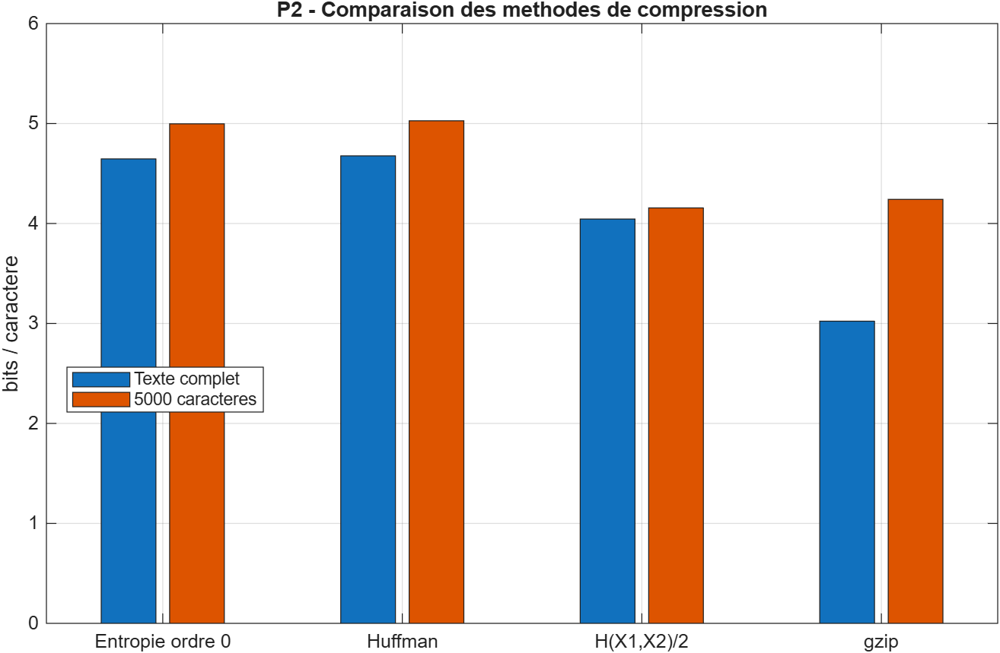
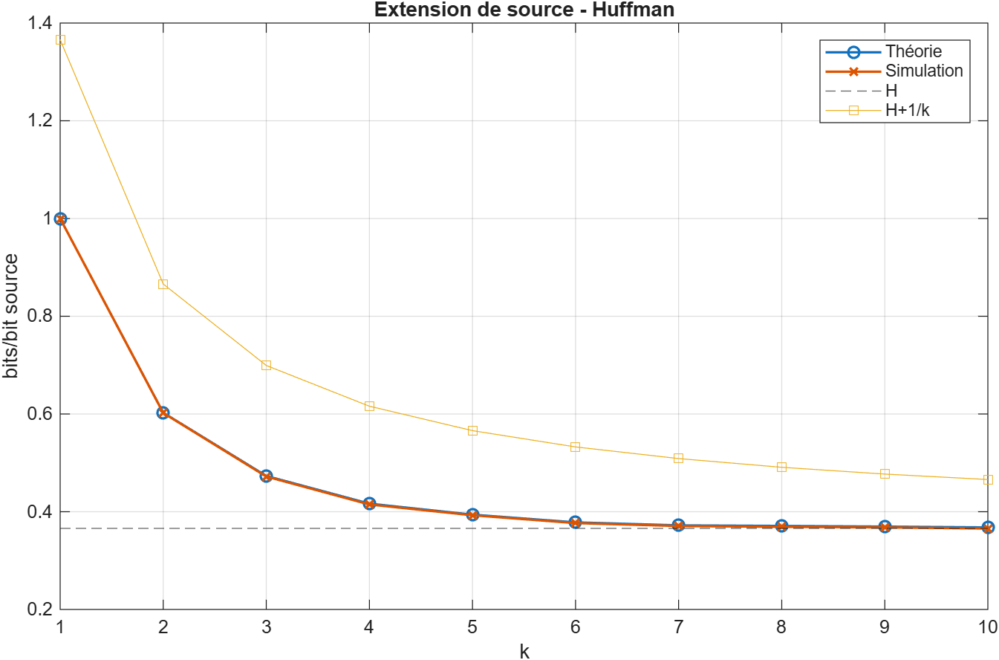
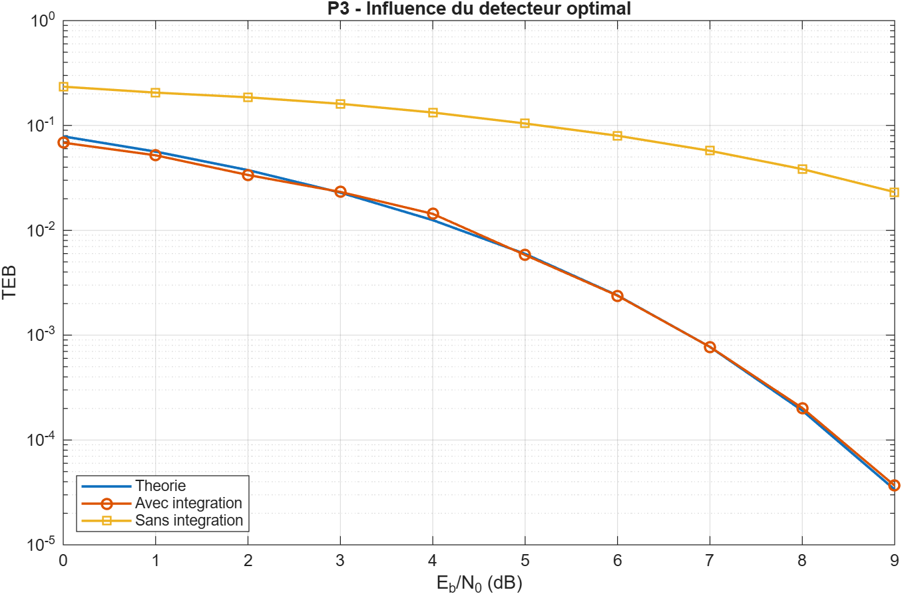
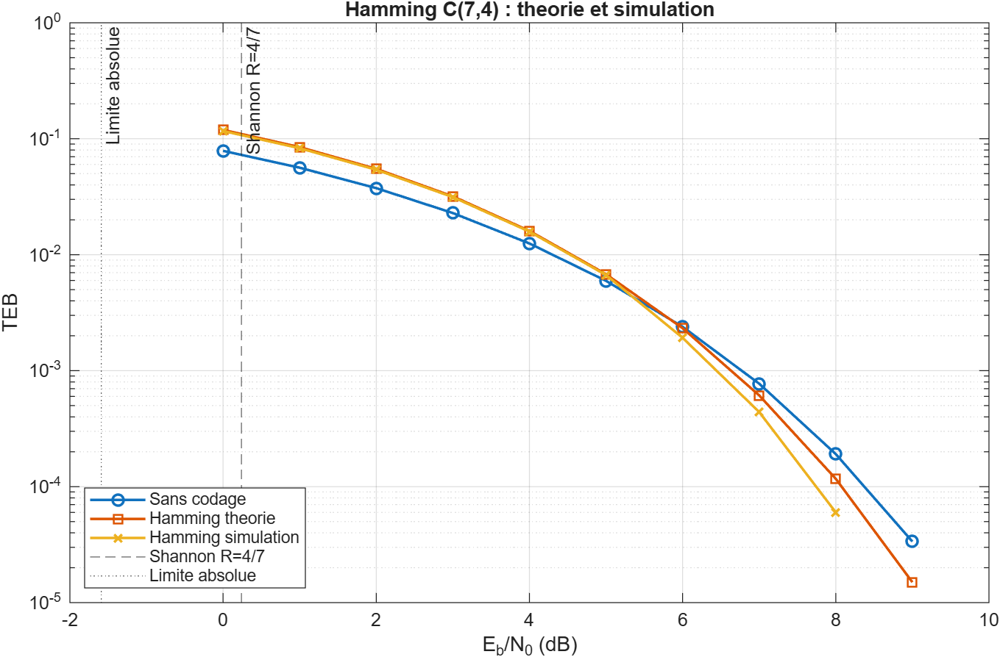
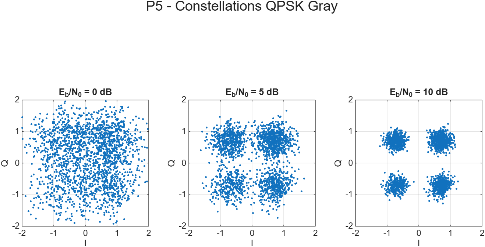
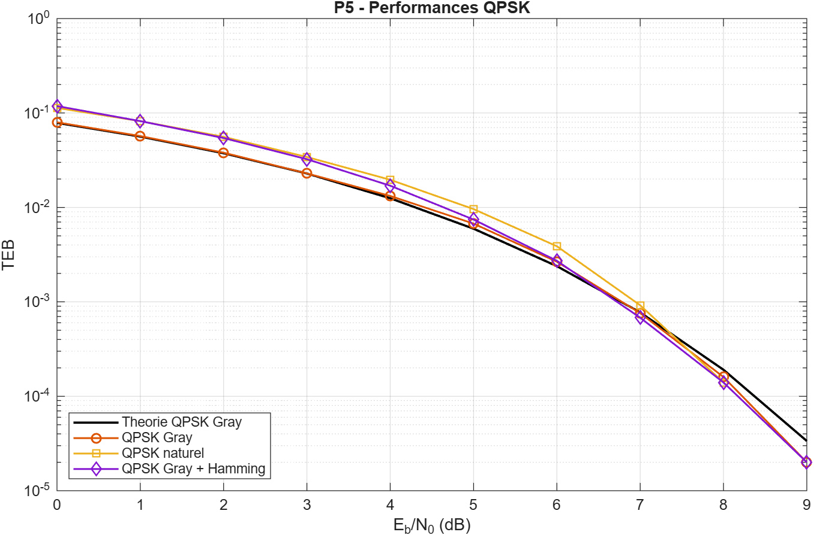
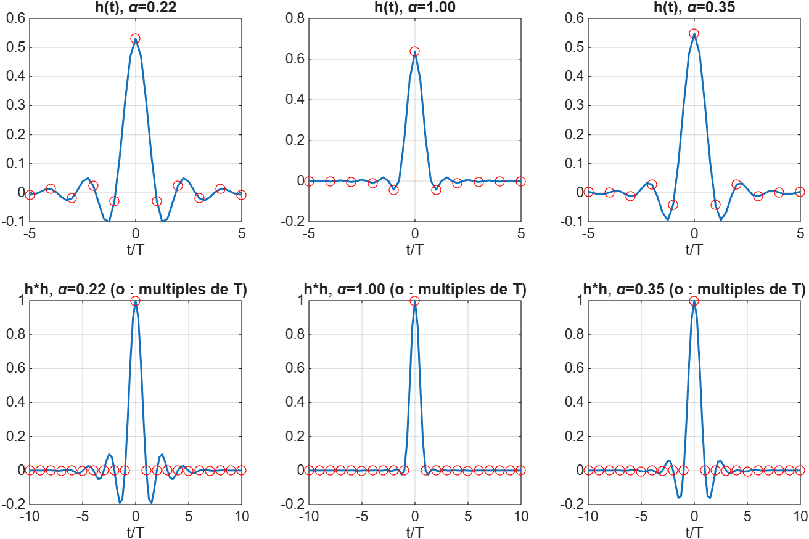
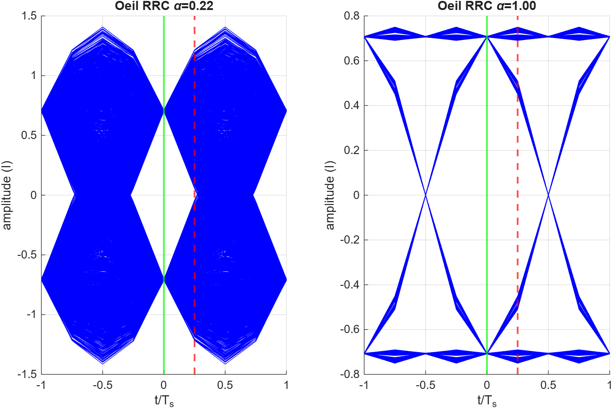
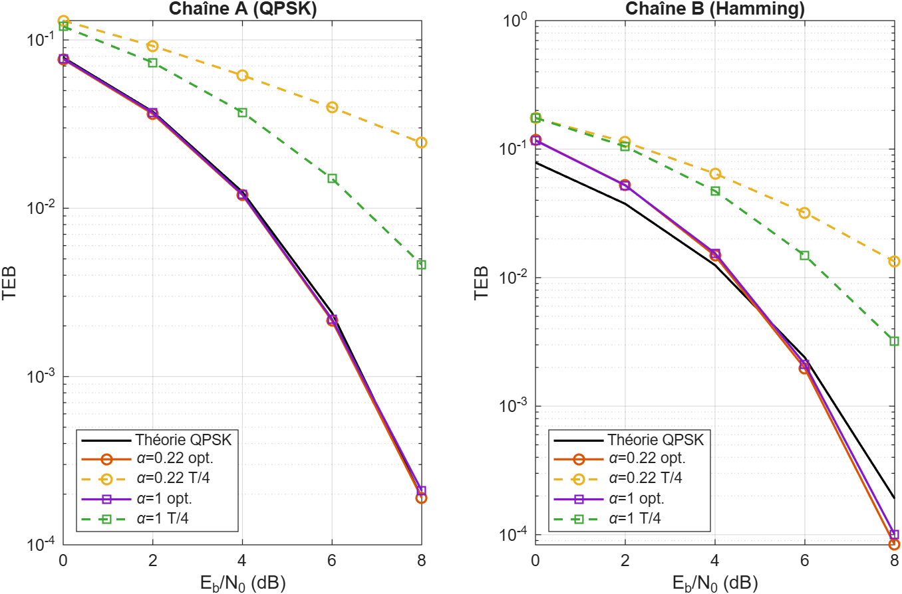
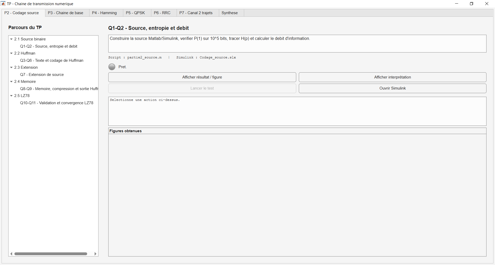

# Théorie de l'information et du codage — Michael Essomba

Projet MATLAB/Simulink réalisé à l'ENSIM autour de la **modélisation et de la simulation d'une chaîne de transmission numérique en bande de base**.

## Objectif du projet

L'objectif est de construire progressivement une chaîne de transmission numérique complète et d'observer l'apport de chaque bloc sur la **fiabilité**, le **taux d'erreur binaire (TEB)**, le **débit** et l'**occupation spectrale**.

La chaîne est enrichie étape par étape :

1. codage de source ;
2. chaîne de transmission de base ;
3. codage de canal Hamming ;
4. modulation QPSK ;
5. mise en forme RRC et filtrage adapté ;
6. complément sur un canal à deux trajets.

Chaque étape est validée par simulation et comparée aux résultats théoriques.

## Vue d'ensemble des résultats
Lien vers la vidéo : <strong><a href="https://drive.google.com/file/d/1389typlhmT1kLnzJHi3HACIOdWoLD4EX/view?usp=sharing" target="_blank" rel="noopener noreferrer">https://drive.google.com/file/d/1389typlhmT1kLnzJHi3HACIOdWoLD4EX/view?usp=sharing</a></strong><br aria-hidden="true">
### 1. Codage de source

La première partie étudie l'entropie, le codage de Huffman, l'extension de source et LZ78. Le but est de réduire la redondance avant transmission.



La comparaison montre que Huffman se rapproche de l'entropie d'ordre 0, tandis que les compresseurs réels peuvent exploiter davantage la mémoire du texte.



L'extension de source permet d'approcher progressivement la limite théorique de l'entropie, au prix d'une complexité croissante.

---

### 2. Chaîne de base et détecteur optimal

La partie 3 compare plusieurs modèles de canal et montre l'intérêt d'exploiter toute l'énergie du bit avec un détecteur optimal.



La courbe avec intégration suit la tendance théorique et présente un TEB nettement inférieur à celui obtenu lorsqu'un seul échantillon est utilisé pour la décision.

---

### 3. Codage de canal Hamming C(7,4)

Le code Hamming ajoute de la redondance afin de détecter et corriger les erreurs simples.



La chaîne codée devient avantageuse lorsque le rapport `E_b/N_0` est suffisamment élevé. Dans les simulations réalisées, le croisement apparaît autour de **5,85 dB** et le gain mesuré vers un TEB de `10^-4` est d'environ **0,31 dB**.

Le coût est un rendement `R = 4/7`, donc une augmentation de **75 % du débit binaire transmis** pour conserver le même débit utile.

---

### 4. Modulation QPSK

La QPSK transporte deux bits par symbole et améliore l'efficacité spectrale.



Lorsque `E_b/N_0` augmente, les nuages de points se resserrent autour des quatre symboles idéaux.



Le mapping Gray limite le nombre d'erreurs binaires lors d'une erreur de décision vers un symbole voisin et présente de meilleures performances que le mapping naturel.

---

### 5. Mise en forme RRC et filtrage adapté

La partie 6 introduit la mise en forme en racine de cosinus surélevé afin de contrôler l'occupation spectrale et l'interférence entre symboles.



La cascade émission-réception réalise un cosinus surélevé et respecte le critère de Nyquist aux instants symboles, à la troncature près.



Le diagramme de l'œil permet de visualiser directement la marge de décision et la sensibilité au décalage temporel.



Le facteur de roll-off `alpha` traduit un compromis entre bande occupée et tolérance aux erreurs de synchronisation.

---

## Parties traitées

| Partie | Contenu |
|---|---|
| 2 | Codage de source : entropie, Huffman, mémoire et LZ78 |
| 3 | Chaîne de base : CBS, bruit uniforme, bruit gaussien et détecteur optimal |
| 4 | Codage canal : Hamming C(7,4), syndrome, registre et performances |
| 5 | Modulation QPSK : Gray, mapping naturel et QPSK + Hamming |
| 6 | Mise en forme : porte, RRC, Nyquist, DSP, œil et sensibilité temporelle |
| 7 | Complément : canal à deux trajets |
| 8 | Synthèse globale : TEB, débit, occupation spectrale et limites de Shannon |

## Structure du dépôt

```text
.
├── matlab/                  # Scripts, fonctions, tests et applications
├── simulink/                # Modèles Simulink
├── docs/                    # Sujet, guide, bibliographie et synthèse
├── assets/
│   ├── figures/             # Figures exportées automatiquement
│   └── videos/              # Démonstration vidéo
├── Projet_guttenberg_Le Fantôme de lOpéra.txt
├── texte_fr.txt
├── resultats_partie6.mat
└── README.md
```

## Application graphique principale

L'application MATLAB sert de point d'entrée interactif pour parcourir l'ensemble du TP.



L'interface est organisée par parties :

- **P2 — Codage source**
- **P3 — Chaîne de base**
- **P4 — Hamming**
- **P5 — QPSK**
- **P6 — RRC**
- **P7 — Canal à deux trajets**
- **Synthèse**

Pour chaque question, l'application affiche le script MATLAB associé, le modèle Simulink lorsqu'il existe, l'état d'exécution ainsi que les résultats et figures générés.

Elle permet notamment :

- d'exécuter directement les scripts MATLAB ;
- d'afficher les figures produites ;
- de consulter l'interprétation des résultats ;
- de lancer les tests de validation ;
- d'ouvrir les modèles Simulink associés.

Depuis la racine du dépôt :

```matlab
addpath(genpath('matlab'));
app_tp_arborescence
```

## Mini-application

Une version en ligne de commande permet de relancer rapidement les scripts et tests :

```matlab
addpath(genpath('matlab'));
lancer_mini_application
```

## Paramètres personnels

Les paramètres des simulations sont centralisés dans :

```text
matlab/parametres_perso.m
```

Les tirages aléatoires utilisent une graine fixe afin de conserver des résultats reproductibles.

## Documentation

- [Guide d'utilisation](docs/GUIDE_UTILISATION.md)
- [Synthèse des résultats](docs/SYNTHESE_RESULTATS.md)
- [Bibliographie et ressources techniques](docs/BIBLIOGRAPHIE.md)
- [Déclaration d'utilisation de l'IA](docs/DECLARATION_IA.md)
- [Sujet du TP](docs/TP_2026-2027_Simulink-2.pdf)

## Export automatique des figures

Les figures du projet peuvent être régénérées sans capture d'écran :

```matlab
addpath(genpath('matlab'));
export_figures_tp
```

Elles sont ensuite enregistrées dans :

```text
assets/figures/
```

## Vidéo de présentation

La démonstration vidéo de l'application et des simulations sera placée dans :

```text
assets/videos/
```
